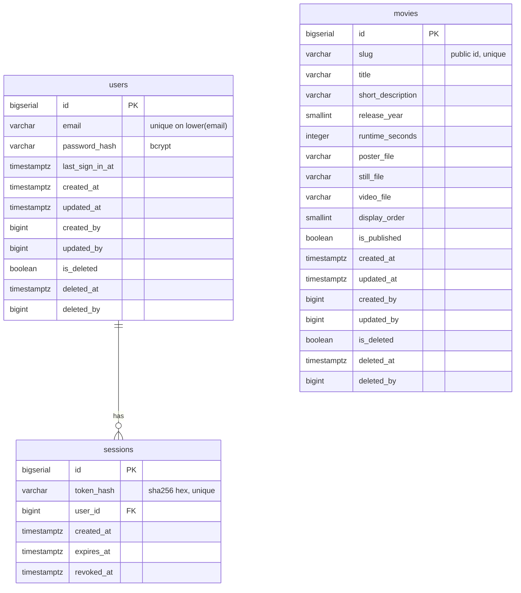

# clover — Entity Relationship Diagram

Cumulative ERD across every feature built for this service, maintained by /code-preparation as part of each feature's own PR.
It is not a substitute for the feature's own `database.md`, which carries the rationale.

## Tables by feature

| Feature | Tables added/changed |
|---|---|
| [FEAT-001](feature/FEAT-001/database.md) | users, movies, sessions |
