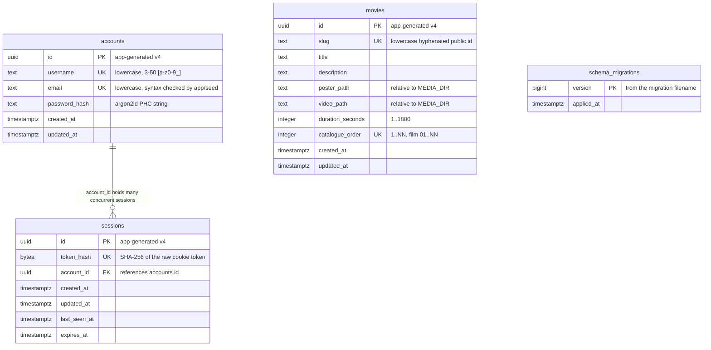

# clover — Entity Relationship Diagram

Cumulative ERD across every feature built for this service, maintained as part of each feature's own docs PR. It shows the combined picture only — each feature's own `database.md` holds the rationale.

## Tables by feature

| Feature | Tables added/changed |
|---|---|
| [feat-001](feature/feat-001/database.md) | movies, accounts, sessions, schema_migrations |
