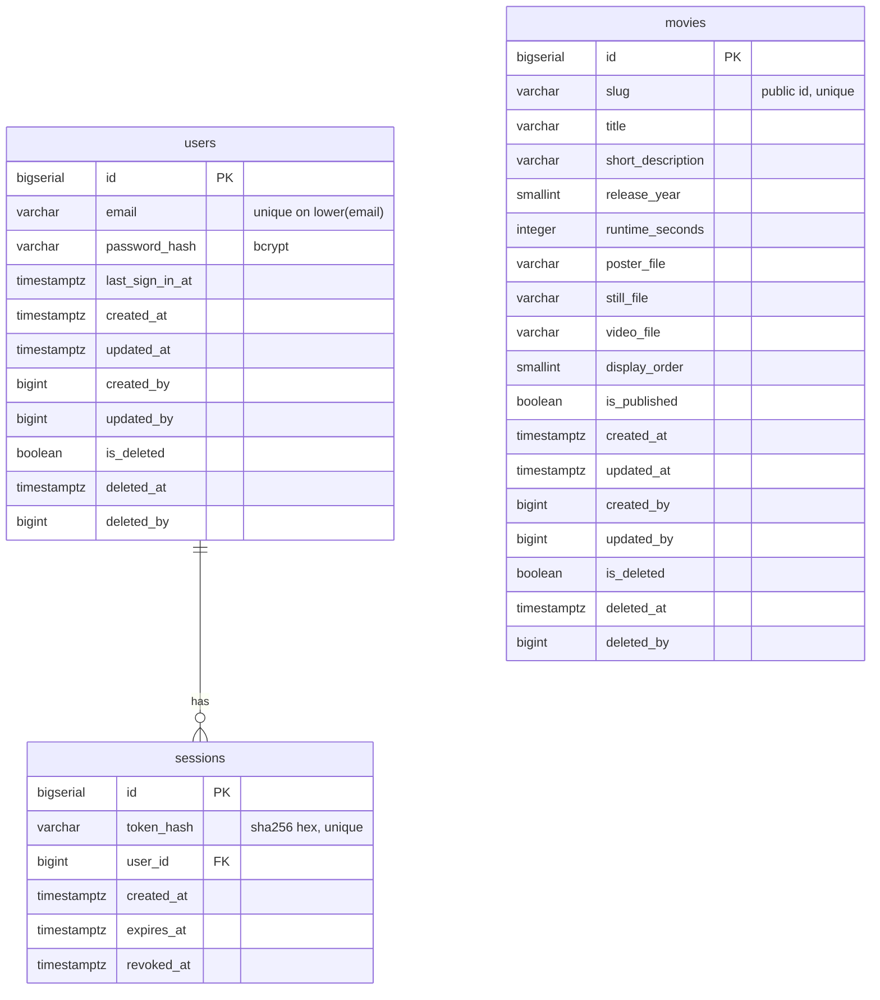

# FEAT-001 — Database design (clover)

PostgreSQL 16, one database, one schema, three tables. This document is the
schema gate's confirmed output for the feature — the ERD, the normalization
decisions, the seed rows and the batched migration plan. It contains **no
DDL**: `/go-dev` writes `migrations/0001_init.sql` and `seed/movies.sql` in
the order below.

`users` and `sessions` are the only tables the running service writes to.
`movies` is seed-only in v1: there is no screen and no route that creates,
edits or deletes a film.

## Conventions applied

- `snake_case` plural table names; FK columns `<singular_table>_id`; booleans
  `is_*`.
- One surrogate `BIGSERIAL id` primary key per table. No table's `id` is ever
  exposed by the API: films are addressed by `slug`, sessions by their token,
  and the only account field the API returns is the email.
- Audit columns on `users` and `movies`:
  `created_at TIMESTAMPTZ NOT NULL DEFAULT now()`,
  `updated_at TIMESTAMPTZ NOT NULL DEFAULT now()`,
  `created_by BIGINT NULL`, `updated_by BIGINT NULL`,
  `is_deleted BOOLEAN NOT NULL DEFAULT FALSE`, `deleted_at TIMESTAMPTZ NULL`,
  `deleted_by BIGINT NULL`.
  `created_by`/`updated_by`/`deleted_by` carry no FK: the actor is a
  `users.id` today, but the column is declared as a plain reference so the
  house convention does not force a self-referencing FK on the account table.
- **Soft delete is the dedicated triple, never a `status` value.** No table in
  v1 has a business `status` column at all — a film is published or not
  (`is_published`), which is a business fact, and deleted or not
  (`is_deleted`), which is a lifecycle fact. They are separate columns and
  both are used.
- `sessions` deliberately carries **no audit triple** (see its table note): it
  is an ephemeral operational row, never edited in place and never
  soft-deleted — sign-out sets `revoked_at` and the row is purged after it
  expires. This matches the precedent already merged for the `dazze` service.
- Every uniqueness requirement is a real `UNIQUE` index, never an application
  pre-check. Every FK is a real constraint with a stated `ON DELETE`.

## Tables

### 1. `users`

| Column | Type | Notes |
|---|---|---|
| `id` | `BIGSERIAL PK` | internal only |
| `email` | `VARCHAR(254) NOT NULL` | surrounding whitespace trimmed once at the request boundary; otherwise stored exactly as typed and never case-folded (REQ-022) |
| `password_hash` | `VARCHAR(72) NOT NULL` | bcrypt output (60 chars at cost 12); the only representation of a password that is ever stored |
| `last_sign_in_at` | `TIMESTAMPTZ NULL` | set on a successful sign-in; never used for authorization |
| `created_at` / `updated_at` | `TIMESTAMPTZ NOT NULL DEFAULT now()` | |
| `created_by` / `updated_by` | `BIGINT NULL` | |
| `is_deleted` / `deleted_at` / `deleted_by` | audit triple | no v1 route sets it |

Constraints and indexes:

- `ux_users_email_lower` — `CREATE UNIQUE INDEX ux_users_email_lower ON users (lower(email)) WHERE NOT is_deleted;`
  This is what makes REQ-022's case-insensitive uniqueness hold, including
  under two concurrent sign-ups: the loser gets a `23505` and the handler
  answers `409 email_taken`. No `SELECT … then INSERT` pre-check exists, and
  the unique constraint must **not** also be declared inline on the column —
  one uniqueness rule, one index.
- `ck_users_email_shape` — `char_length(email) BETWEEN 3 AND 254 AND position('@' in email) > 1 AND email = btrim(email)`.
  Syntax is validated in the application (one regex, one message); the CHECK
  only stops a value that could never be an address or that would make
  `" ann@example.com"` and `"ann@example.com"` two accounts.
- `ck_users_password_hash` — `password_hash ~ '^\$2[aby]\$[0-9]{2}\$.{53}$'` so a
  plaintext or empty value can never be written by a future code path.
- `ck_users_soft_delete` — `is_deleted = (deleted_at IS NOT NULL)` so the
  lifecycle triple cannot contradict itself.
- `updated_at` is bumped by the service on every write; no trigger.

Every lookup on this table carries the same predicate as the partial index
(`… AND NOT is_deleted`), or the planner cannot use it.

### 2. `movies`

| Column | Type | Notes |
|---|---|---|
| `id` | `BIGSERIAL PK` | internal only |
| `slug` | `VARCHAR(64) NOT NULL` | the public, readable id: used in `/play/{slug}` and `/v1/movies/{slug}` |
| `title` | `VARCHAR(200) NOT NULL` | |
| `short_description` | `VARCHAR(500) NOT NULL` | the one-line description on the card, the auth screen and the player (REQ-001) |
| `release_year` | `SMALLINT NOT NULL` | the year chip and the player meta |
| `runtime_seconds` | `INTEGER NOT NULL` | atomic value; the UI formats "2h 06m" itself |
| `poster_file` | `VARCHAR(128) NOT NULL` | filename in `media/poster/`, **not** a URL |
| `still_file` | `VARCHAR(128) NULL` | wide still behind the player and the auth screen; null when a film has none |
| `video_file` | `VARCHAR(128) NOT NULL` | filename in `media/video/`, resolved server-side |
| `display_order` | `SMALLINT NOT NULL` | catalogue order; the seed order in `ui/mock/app.js` |
| `is_published` | `BOOLEAN NOT NULL DEFAULT TRUE` | business state: shown in the catalogue |
| audit columns | | as above |

Constraints and indexes:

- `ux_movies_slug` — `CREATE UNIQUE INDEX ux_movies_slug ON movies (slug) WHERE NOT is_deleted;`
  The slug is the public id, so it must be unique; the partial predicate lets a
  withdrawn film's slug be reused later without a conflict. Only this index —
  the column is not additionally declared `UNIQUE`.
- `ix_movies_catalogue` — `CREATE INDEX ix_movies_catalogue ON movies (display_order) WHERE is_published AND NOT is_deleted;`
  The catalogue query is exactly `WHERE is_published AND NOT is_deleted ORDER BY display_order, id`.
  The `id` tiebreak makes the order deterministic even if two films ever share
  a `display_order`; `display_order` itself is not made unique because a future
  reorder would then need deferred constraints for a swap.
- `ck_movies_slug` — `slug ~ '^[a-z0-9-]{1,64}$'` (also what the `/auth?next=` guard relies on).
- `ck_movies_file_names` — each of `poster_file`, `still_file`, `video_file`
  must match `^[a-z0-9][a-z0-9._-]{0,127}$` **and** `position('..' in file) = 0`
  (null allowed for `still_file`). A row can therefore never contain `/`, `..`
  or an absolute path, which is the second half of the path-traversal defence:
  the URL never carries a path, and the column cannot hold one either.
- `ck_movies_release_year` — `release_year BETWEEN 1888 AND 2100`.
- `ck_movies_runtime` — `runtime_seconds > 0`.
- `ck_movies_display_order` — `display_order > 0`.
- `ck_movies_soft_delete` — `is_deleted = (deleted_at IS NOT NULL)`.

### 3. `sessions`

| Column | Type | Notes |
|---|---|---|
| `id` | `BIGSERIAL PK` | internal only; a session is addressed by its token, never by id |
| `token_hash` | `VARCHAR(64) NOT NULL` | hex SHA-256 of the 32-byte token; the raw token exists only in the cookie |
| `user_id` | `BIGINT NOT NULL` | FK → `users(id)` `ON DELETE CASCADE` |
| `created_at` | `TIMESTAMPTZ NOT NULL DEFAULT now()` | sign-in time |
| `expires_at` | `TIMESTAMPTZ NOT NULL DEFAULT (now() + interval '7 days')` | absolute, never renewed (REQ-007); defaulted from the **database** clock so app-clock skew cannot stretch or shrink the lifetime |
| `revoked_at` | `TIMESTAMPTZ NULL` | set by sign-out (REQ-020) |

No audit triple, deliberately: a session row is operational state, is never
edited in place, and is never soft-deleted — `revoked_at` is its lifecycle
fact and the row is deleted once it has expired.

Constraints and indexes:

- `ux_sessions_token_hash` — `CREATE UNIQUE INDEX ux_sessions_token_hash ON sessions (token_hash);`
  Two identical tokens must be impossible; the lookup is by hash, so this is
  also the access path.
- `ix_sessions_user_id` — `CREATE INDEX ix_sessions_user_id ON sessions (user_id);`
  Backs the FK and any per-account revocation.
- `ix_sessions_expiry` — `CREATE INDEX ix_sessions_expiry ON sessions (expires_at);`
  Plain, not partial: the purge is `DELETE FROM sessions WHERE expires_at < now()`,
  which must also find revoked-but-not-yet-expired rows.
- `ck_sessions_token_hash` — `token_hash ~ '^[0-9a-f]{64}$'`.
- `ck_sessions_expiry` — `expires_at > created_at`.
- A session is live iff `revoked_at IS NULL AND expires_at > now()`. That
  predicate is applied on every request, in the one store function that
  resolves a cookie, so no handler can forget it.

### The authentication query (implementation contract)

Session resolution is **one statement**, against the database clock, so
revocation, expiry and a soft-deleted account cannot be missed by a second
lookup:

```sql
SELECT s.user_id, u.email
FROM sessions s
JOIN users u ON u.id = s.user_id
WHERE s.token_hash = $1
  AND s.revoked_at IS NULL
  AND s.expires_at > now()
  AND NOT u.is_deleted;
```

Zero rows means unauthenticated — the same answer for a missing cookie, an
unknown token, an expired session and a revoked one, which is exactly what
REQ-020 requires (the caller learns only "not signed in"). Sign-out is
`UPDATE sessions SET revoked_at = now() WHERE token_hash = $1 AND revoked_at IS NULL`,
idempotent and race-safe.

A request already streaming when sign-out lands may finish its in-flight
range response; every subsequent request is refused. That is stated here
rather than papered over.

## ERD



`movies` has no relationship: v1 records no viewing, ownership or preference
per film. That is a deliberate absence, not a missing table — history,
watchlists and resume position are explicitly out of scope.

## Relationships and referential choices

| Relationship | Cardinality | `ON DELETE` | Reason |
|---|---|---|---|
| `sessions.user_id` → `users.id` | many sessions : one user (REQ-021 — several devices) | `CASCADE` | A deleted account's sessions must not outlive it. v1 has no delete route, so this is a safety net rather than an exercised path. |

## Indexes

| Index | Definition | Serves |
|---|---|---|
| `ux_users_email_lower` | unique `lower(email)` where not deleted | Sign-in lookup and sign-up uniqueness (REQ-022, REQ-023) |
| `ux_movies_slug` | unique `slug` where not deleted | Film detail, the player route, the video route |
| `ix_movies_catalogue` | `(display_order)` where published and not deleted | The catalogue list (REQ-001, REQ-002) |
| `ux_sessions_token_hash` | unique `token_hash` | Session resolution on every authenticated request (REQ-007, REQ-020) |
| `ix_sessions_user_id` | `user_id` | FK backing; "revoke this account's other sessions" if it is ever added |
| `ix_sessions_expiry` | `expires_at` | The hourly purge of expired rows |

Every FK has a backing index. Every column the service filters or sorts on —
`lower(email)`, `slug`, `is_published` + `display_order`, `token_hash`,
`expires_at` — is indexed. The catalogue is 13 rows, so this is cheap today
and correct when it is not.

## Access control

| Data | Anonymous visitor | Signed-in user | Service process |
|---|---|---|---|
| `movies` (published) | read via `GET /v1/movies` and `GET /v1/movies/{slug}` | read | read + seed upsert at startup |
| Video file for a published film | none — `GET /v1/movies/{slug}/video` is 401 | read, any published film | read |
| `users` | none | **own row only** (`GET /v1/auth/me` returns just the email) | read, insert; update on sign-in timestamp |
| `sessions` | none | **own session only**; sign-out revokes exactly the session named by the cookie | read, insert, update `revoked_at`, delete expired |

There is no admin role, no operator role and no cross-account read. A signed-in
user can stream any published film by design: the account gates *watching*,
not *which* film.

### Database roles and connection

Two roles, not one:

- `clover_migrator` owns the schema and runs `migrations/` (DDL only).
- `clover_app` is the runtime login: `SELECT`, `INSERT`, `UPDATE` on `users`,
  `movies` and `sessions`, `DELETE` on `sessions` **only** (the hourly purge),
  no DDL, no ownership. It also runs the startup seed (see decision 6 below),
  which is why it needs write access to `movies`; no request path ever writes
  that table.

`REVOKE ALL ON SCHEMA public FROM PUBLIC` and revoke `CREATE` on the schema, so
a compromised runtime credential cannot add objects. Migrations and the
running service never share a credential.

The runtime DSN comes from `DATABASE_URL`; `MIGRATE_DATABASE_URL` (the
`clover_migrator` credential) is optional and, when set, the app applies
migrations before it seeds and serves. Local Docker Compose may run both
roles from one development cluster; the role split and the grants are part of
`migrations/0001_init.sql`, not prose. PostgreSQL is never published outside
the compose network; `sslmode` is `prefer` inside compose and `verify-full`
where the deployment provides a certificate (`APP_ENV=production` refuses to
start with `sslmode=disable`).

## Normalization decisions

Three tables, each in 3NF. Advisory review findings:

- **No repeating groups.** One row per user, one row per film, one row per
  session. Multi-device sessions are multiple rows in `sessions`, not an array
  column on `users` — the correct decomposition for REQ-021.
- **No partial dependencies.** The only composite-unique thing in the schema is
  an index expression, not a key.
- **No transitive dependencies.** Nothing on `sessions` repeats a `users`
  column (no `sessions.user_email`); the email is reached through the FK when
  it is needed, which is only at `/v1/auth/me`.
- **`runtime_seconds` is atomic; the formatted "2h 06m" is not stored.** The
  display string is mechanically derivable from the integer, so storing it
  would be a derived redundancy. The UI formats it.
- **`release_year` is a `SMALLINT`, not a date.** v1 has no exact release date
  and no query on one; storing a date would invent precision the source does
  not have.
- **`lower(email)` is an index expression, not a stored column.** The
  case-folded form is mechanically derivable from `email`, so it is not a
  column; the unique index carries it. This keeps one source of truth for the
  address while still enforcing REQ-022 in the database.
- **Surrounding whitespace is trimmed from the email once, at the request
  boundary.** Deliberate and narrow: without it, `" ann@example.com"` and
  `"ann@example.com"` would be two accounts and the case-insensitive
  uniqueness rule would be undermined. The no-trim/no-fold rule in REQ-023 and
  REQ-024 applies to the **password**, which is never touched.
- **`movies.slug` is a stored snapshot, not derived from the title.**
  Deliberate: a public URL must not change when a title is re-worded or
  corrected. The same reasoning applies to `sessions.expires_at` (a policy
  snapshot — recomputing it at read time would silently change the lifetime of
  already-issued sessions) and to `users.last_sign_in_at` (a snapshot of the
  last successful sign-in, which is not the same fact as "newest session row").
- **Three file columns instead of a `movie_assets` table.** Deliberate: the set
  of asset roles is fixed at three and each has its own nullability and
  meaning; a `kind` discriminator would add a join and a CHECK for no gain.
- **File columns hold filenames, not URLs.** Deliberate: a stored absolute URL
  would bake an environment's host and scheme into a seed row and could point
  at a different origin than the one serving the session-gated stream. The
  service composes `poster_url`/`still_url` from the filename, and the video
  URL from the slug.
- **`display_order` is a stored ordering, not seed order by `id`.** Deliberate:
  `id` order would change if the seed were ever re-run against a database that
  already had rows in a different order, and the catalogue order is a curated
  product decision (it is the mock's `FILMS` order).
- **`sessions` has no audit triple.** Deliberate operational-table exception,
  stated above — `created_at`, `expires_at` and `revoked_at` are the only
  lifecycle facts a session has.
- **No denormalized counters.** The catalogue count in the UI ("13 films") is
  `len(items)` on the client; nothing is stored.

## Seed data

`seed/movies.sql` is applied at startup, inside one transaction, after
migrations. It is a single `INSERT … ON CONFLICT (slug) WHERE NOT is_deleted
DO UPDATE … WHERE (movies.title, …) IS DISTINCT FROM (excluded.title, …)`. The
conflict target must repeat the partial index's predicate — without
`WHERE NOT is_deleted` the inference fails and the statement errors. So:

- a fresh database comes up with the 13 v1 films already present;
- a second start writes nothing (the `WHERE` makes the upsert a no-op), which
  is what makes "idempotent" checkable rather than merely claimed;
- a deliberate edit to the seed file is applied on the next start.

Rows (order = `display_order`). All 13 point at the one sample clip; posters and
stills are the approved mock's placeholder images, copied from
`clover/feature/FEAT-001/ui/mock/assets/img/` into `media/`.

| # | slug | title | year | runtime_seconds | poster_file | still_file | video_file |
|---|---|---|---|---|---|---|---|
| 1 | `halcyon` | Halcyon Bay | 2023 | 7560 | `p-halcyon.jpg` | `still-halcyon.jpg` | `clover-sample.mp4` |
| 2 | `quiet` | The Quiet Province | 2025 | 6240 | `p-quiet.jpg` | `still-quiet.jpg` | `clover-sample.mp4` |
| 3 | `vesper` | Vesper Light | 2022 | 6660 | `p-vesper.jpg` | `still-vesper.jpg` | `clover-sample.mp4` |
| 4 | `cartographer` | The Cartographer | 2024 | 7080 | `p-cartographer.jpg` | `still-quiet.jpg` | `clover-sample.mp4` |
| 5 | `meridian` | Meridian Line | 2021 | 7920 | `p-meridian.jpg` | `still-vesper.jpg` | `clover-sample.mp4` |
| 6 | `glasshouse` | Glasshouse Summer | 2024 | 5940 | `p-glasshouse.jpg` | `still-halcyon.jpg` | `clover-sample.mp4` |
| 7 | `fathoms` | Nine Fathoms | 2023 | 6420 | `p-fathoms.jpg` | `still-halcyon.jpg` | `clover-sample.mp4` |
| 8 | `lowcountry` | Low Country | 2022 | 7440 | `p-lowcountry.jpg` | `still-quiet.jpg` | `clover-sample.mp4` |
| 9 | `saltyear` | The Salt Year | 2025 | 5760 | `p-saltyear.jpg` | `still-vesper.jpg` | `clover-sample.mp4` |
| 10 | `lanterns` | Paper Lanterns | 2024 | 6120 | `p-lanterns.jpg` | `still-vesper.jpg` | `clover-sample.mp4` |
| 11 | `harbour` | Harbour Lights | 2021 | 6900 | `p-harbour.jpg` | `still-halcyon.jpg` | `clover-sample.mp4` |
| 12 | `understudy` | The Understudy | 2023 | 5460 | `p-understudy.jpg` | `still-quiet.jpg` | `clover-sample.mp4` |
| 13 | `static` | Static | 2025 | 6540 | `p-static.jpg` | `still-vesper.jpg` | `clover-sample.mp4` |

The 13 `short_description` values are copied verbatim from the approved mock's
`FILMS` entries in `ui/mock/app.js` (including their typographic apostrophes) —
they are already-approved English copy and must not be re-worded.

`runtime_seconds` is the mock's own duration converted exactly (`2h 06m` →
7560), so the player meta and the card agree with the approved design.

The sample clip must be MP4/H.264 with the `moov` atom before `mdat`
(faststart). The mock's `assets/video/clover-sample.mp4` was generated with
ffmpeg; `/go-dev` copies it and checks it, re-muxing with
`-movflags +faststart` if the check fails — otherwise progressive playback
(REQ-009, TC-021) waits for the whole file.

**Test-only fixtures are not seeded.** The corrupt/unavailable movie that
REQ-018's test needs is created by the test itself (and covered by the
`video_unavailable` path), never by the production seed.

## Migration batches

One batch, because the schema is three tables with one dependency. `/go-dev`
writes it as a single file and the runner applies it once.

```
Batch 1  roles + grants, users, movies, sessions, indexes and CHECKs
```

Creation order within the batch: `users` → `movies` → `sessions` (the FK
depends on `users`), then the indexes, then the two roles and their grants.

**Batch 1 validation** — on a fresh database:

- the three tables exist with the audit columns on `users` and `movies`;
- `INSERT INTO users (email, password_hash) VALUES ('Ann@Example.com', <hash>)`
  then the same address as `ann@example.com` fails on `ux_users_email_lower`,
  and `' Ann@Example.com'` fails `ck_users_email_shape`;
- a `password_hash` that is not a bcrypt string fails `ck_users_password_hash`;
- `is_deleted = true` with `deleted_at = NULL` fails `ck_users_soft_delete`
  (and the same on `movies`);
- a film with `slug = 'Halcyon'` or `slug = '../etc'` fails its CHECK, and
  `video_file = '../x.mp4'` fails `ck_movies_file_names`;
- a session's `expires_at` defaults to `created_at + interval '7 days'`, and
  an explicit `expires_at = created_at` fails `ck_sessions_expiry`; a
  `token_hash` of 63 hex characters fails `ck_sessions_token_hash`;
- deleting a `users` row deletes its sessions (`CASCADE`);
- `clover_app` cannot `CREATE TABLE` in `public`, and cannot `DELETE` from
  `users` or `movies`;
- the seed, run twice, leaves exactly 13 rows and changes nothing on the second
  run (`updated_at` equal before and after);
- `EXPLAIN` on the catalogue query uses `ix_movies_catalogue`, on the sign-in
  lookup uses `ux_users_email_lower`, on session resolution uses
  `ux_sessions_token_hash`, and on the purge uses `ix_sessions_expiry`.

## Decisions recorded while confirming the design

1. **PostgreSQL, not an embedded database.** The house runs PostgreSQL with a
   compose service and the verification stack already provisions it; a
   single-file database would remove a service but leave this feature as the
   only deployment shape in the organisation that works differently. The
   manager's "nothing extra to run" constraint is about video delivery (no
   streaming server), not about the database.
2. **`sessions` keeps `revoked_at` instead of deleting the row on sign-out.**
   Revocation stays queryable and the check is one predicate; the purge job
   removes expired rows on its own schedule. TC-015 only requires the cookie to
   stop working, which `revoked_at IS NULL` delivers immediately.
3. **Absolute 7-day expiry, no sliding renewal.** TC-012 tests the lifetime
   boundary; a sliding window would make "just before 7 days" undefined.
4. **`token_hash`, never the token.** A database leak must not hand over live
   sessions.
5. **`display_order` is stored.** The catalogue order is product content, not an
   incidental of how rows were inserted.
6. **One runtime credential for the app, including the startup seed.** The app
   process applies the migration with `clover_migrator` only when
   `MIGRATE_DATABASE_URL` is set (the deploy path), and seeds the catalogue
   with its own credential on every start. The catalogue still cannot be
   changed by a request: no route writes `movies`; only the startup seed does.
