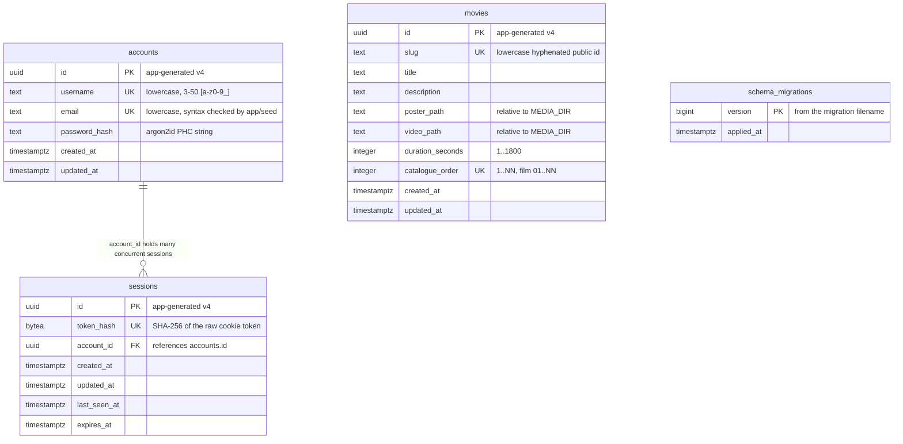

# feat-001 — Movie Streaming (Clover v1) — database design

Confirmed output of the schema-design gate for `clover-be` (PostgreSQL 16).
This document is the design authority for `/go-dev`; it contains **no DDL and
no migration files** — the implementation writes those from this design.

## Overview

Three domain tables and one infrastructure table:

- `movies` — the seeded catalogue. Read-only to the application.
- `accounts` — pre-created accounts. Written only by the seed command.
- `sessions` — one row per sign-in, hard-deleted on sign-out or expiry.
- `schema_migrations` — the migration runner's bookkeeping (infrastructure,
  not a domain entity, never joined by application queries).

No soft delete exists anywhere: v1 deletes no movie and no account, and a
session is removed for real when the viewer signs out — lifecycle, not a
business status. There is deliberately no `status` column carrying a
`deleted` value.

## Confirmed decisions

The gate proposed several key choices; this section records the final call.

| Question | Decision | Reason |
|---|---|---|
| Surrogate vs natural primary keys | **Surrogate UUID `id` on every table; the natural key is a `UNIQUE` constraint** (`movies.slug`, `accounts.username`/`email`, `sessions.token_hash`) | House rule "one surrogate primary key per table, even when a natural key exists"; the API never exposes the row number, and a future feature can foreign-key to `movies.id` without the slug becoming load-bearing |
| Case-insensitive identifiers | **Normalize to lowercase on write and store lowercase**, with plain `UNIQUE` constraints plus `CHECK (value = lower(value))` | The service already lowercases the identifier for lookup, so a plain equality index is used; `citext` would add an extension for no benefit at this scale, and a `lower()` functional index would duplicate the rule into every query |
| Password hash | **argon2id**, PHC-encoded (`$argon2id$v=19$m=19456,t=2,p=1$…`), salt per hash | REQ-026 allows 128-character passwords; bcrypt truncates at 72 bytes. Parameters travel with the hash, so they can be raised by rewriting hashes, not by a schema change |
| Session expiry | **Fixed 30 days, sliding**: a request after 24 h extends `expires_at` once and updates `last_seen_at` | REQ-007 wants "signed in until sign-out"; a fixed-only expiry would sign out an active viewer at day 30. Expired rows are deleted opportunistically on login |
| Movie catalogue order | **`catalogue_order` integer, unique** | The mock's editorial order is what "Film 01 / 20" means; title order would silently reorder the grid |
| Session `updated_at` | **Present and real** (sliding expiry writes it), alongside `created_at` and `last_seen_at` | The house audit rule holds because the column actually changes |
| No soft-delete columns | **Deliberately absent** | No delete path exists for movies or accounts; adding the columns now would be dead machinery |

## ERD

There is no session-to-movie, account-to-movie or per-movie ACL table:
playback authorization is exactly "a valid session exists" (REQ-011), checked
by the application before any bytes are written.

## Tables

### `movies`

Seed-owned catalogue; the application only issues `SELECT`s.

| Column | Type | Null | Notes |
|---|---|---|---|
| `id` | `uuid` | no | PK, generated by the seed command |
| `slug` | `text` | no | Public id used in `/watch/{movieId}` and media URLs |
| `title` | `text` | no | Display title |
| `description` | `text` | no | The card's two-line short description |
| `poster_path` | `text` | no | Relative to `MEDIA_DIR`, e.g. `posters/amber-drift.webp` |
| `video_path` | `text` | no | Relative to `MEDIA_DIR`, e.g. `videos/amber-drift.mp4` |
| `duration_seconds` | `integer` | no | Real file duration, 1–1800 |
| `catalogue_order` | `integer` | no | Editorial position, unique, ≥ 1 |
| `created_at` | `timestamptz` | no | `DEFAULT now()` |
| `updated_at` | `timestamptz` | no | `DEFAULT now()`, set by the seed's upsert on conflict |

Constraints:

- `PRIMARY KEY (id)`; `UNIQUE (slug)`; `CHECK (slug ~ '^[a-z0-9]+(-[a-z0-9]+)*$')`.
- `UNIQUE (catalogue_order)`; `CHECK (catalogue_order >= 1)` — deliberately no
  upper bound tied to 20 or 50, because catalogue size is content, not schema.
- `CHECK (duration_seconds BETWEEN 1 AND 1800)` — REQ-029's 30-minute ceiling.
- `CHECK (btrim(title) <> '')`, and the same non-empty check for
  `description`, `poster_path`, `video_path` — REQ-029's required fields.

### `accounts`

Seed-owned accounts; no self-service write path exists in v1.

| Column | Type | Null | Notes |
|---|---|---|---|
| `id` | `uuid` | no | PK, generated by the seed command |
| `username` | `text` | no | Stored lowercase, unique |
| `email` | `text` | no | Stored lowercase, unique |
| `password_hash` | `text` | no | argon2id PHC string |
| `created_at` | `timestamptz` | no | `DEFAULT now()` |
| `updated_at` | `timestamptz` | no | `DEFAULT now()` |

Constraints:

- `PRIMARY KEY (id)`; `UNIQUE (username)`; `UNIQUE (email)`.
- `CHECK (username ~ '^[a-z0-9_]{3,50}$')` — encodes REQ-025's trim,
  length and character-set rule after lowercasing.
- `CHECK (email = lower(email) AND btrim(email) <> '')` — lowercase and
  non-empty; **syntax is validated by the application and the seed tool**, not
  by a database regex (a full email regex is a maintenance trap).
- `CHECK (password_hash LIKE '$argon2id$%')` — a cheap guard that no plaintext
  or foreign hash format ever lands in the column.

The uniqueness constraints are compared case-insensitively **by construction**
because the stored values are already lowercase (REQ-027). A future writer that
stores mixed case fails the CHECK rather than silently creating a duplicate.

### `sessions`

One row per successful sign-in. Inserted on login, updated on sliding expiry,
hard-deleted on sign-out and on expiry cleanup.

| Column | Type | Null | Notes |
|---|---|---|---|
| `id` | `uuid` | no | PK, generated on login |
| `token_hash` | `bytea` | no | SHA-256 (32 bytes) of the raw cookie token; unique |
| `account_id` | `uuid` | no | FK → `accounts(id)` |
| `created_at` | `timestamptz` | no | Login time |
| `updated_at` | `timestamptz` | no | Last row change |
| `last_seen_at` | `timestamptz` | no | Last request that used the session |
| `expires_at` | `timestamptz` | no | `created_at + 30 days`, extended on use |

Constraints:

- `PRIMARY KEY (id)`; `UNIQUE (token_hash)`; `CHECK (octet_length(token_hash) = 32)`.
- `FOREIGN KEY (account_id) REFERENCES accounts(id)` — deliberately
  **`RESTRICT`** (no cascade): the plan never deletes an account, and a cascade
  would silently destroy sessions; a real account deletion would be a reviewed
  migration.
- `CHECK (expires_at > created_at)`.

The raw token is never stored; the cookie carries it and the service looks the
session up by its SHA-256 hash (REQ-021's revocation path is a `DELETE` on this
row).

### `schema_migrations`

| Column | Type | Null | Notes |
|---|---|---|---|
| `version` | `bigint` | no | PK, from the filename (`0001` → `1`) |
| `applied_at` | `timestamptz` | no | `DEFAULT now()` |

Created with `CREATE TABLE IF NOT EXISTS` by the runner before it reads applied
versions, so there is no chicken-and-egg with migration `0001`.

## Normalization review

The model is in 1NF, 2NF and 3NF. The gate's advisory findings and the final
call on each:

| Finding | Decision |
|---|---|
| `username` + `email` as two columns instead of an `account_identifiers` table | **Keep two columns.** Both values are mandatory, fixed in count and differently validated; a generic identifiers table would add a join and an enum to the sign-in hot path for no benefit. Deliberate. |
| `poster_path` is mechanically derivable from the slug today | **Keep it stored.** The poster reference is a required product field (REQ-029), and the asset layout (extension, folder, later a CDN key) must be a data decision, not a hardcoded backend convention. Deliberate derived-but-stored column. |
| `catalogue_order` could be derived from insertion order | **Keep the explicit column.** Editorial order is not derivable from any other column and title order would change the grid silently. |
| Single `movies` table instead of `catalogues` + `catalogue_movies` | **Keep one table.** Multi-catalogue is a stated non-goal; the join model would be speculative. |
| Catalogue count shown as "20 films" | **Computed with `COUNT(*)`/array length at query time**, never stored — no transitive dependency. |
| `duration_seconds` integer rather than `interval` | **Integer seconds.** Simpler for JSON, comparisons and the 1800 s rule; no interval arithmetic exists. |
| `sessions` has `updated_at` though most rows are never updated | **Keep it**, because sliding expiry genuinely updates the row; the deviation the gate flagged does not apply once expiry slides. |

No denormalization is unreviewed: the two stored-but-derivable values
(`poster_path`, `catalogue_order`) are deliberate and stated here.

## Indexes

Every foreign key and every column a list/lookup filters on is indexed. All
unique constraints are implemented by Postgres as unique btree indexes.

| Index / constraint | Definition | Query it serves |
|---|---|---|
| `movies_pkey` | PK `(id)` | FK target for future features; row identity |
| `movies_slug_key` | UNIQUE `(slug)` | `WHERE slug = $1` — player page and media routes (REQ-018) |
| `movies_catalogue_order_key` | UNIQUE `(catalogue_order)` | `ORDER BY catalogue_order` — the catalogue list (REQ-002); also prevents duplicate "Film NN" |
| `accounts_pkey` | PK `(id)` | FK target for `sessions.account_id`; loading the signed-in viewer |
| `accounts_username_key` | UNIQUE `(username)` | Sign-in by username (`WHERE username = $1`) |
| `accounts_email_key` | UNIQUE `(email)` | Sign-in by email; the combined `WHERE username = $1 OR email = $1` uses a BitmapOr of both |
| `sessions_pkey` | PK `(id)` | Row identity |
| `sessions_token_hash_key` | UNIQUE `(token_hash)` | Every authenticated request (`WHERE token_hash = $1`) and sign-out `DELETE` — the hot path |
| `sessions_account_id_idx` | `(account_id)` | FK support and "all sessions for this account" |
| `sessions_expires_at_idx` | `(expires_at)` | Opportunistic expired-session cleanup on login (`DELETE WHERE expires_at < now()`) |
| `schema_migrations_pkey` | PK `(version)` | The runner's applied-version check |

**Deliberately not indexed:** `movies.title`, `movies.description`,
`movies.duration_seconds` (no search/filter/sort in v1 — non-goal); the
`created_at`/`updated_at` columns (no query filters on them).

## Migration plan

A small Go runner using `pgx` and `embed.FS`; no migration framework. Startup
takes a session-level `pg_advisory_lock` on a fixed constant so two instances
cannot race, creates `schema_migrations` if absent, reads applied versions and
applies pending files in ascending order. **One transaction per migration**
(begin → file → insert version → commit); a failure rolls back both. Forward
only in v1 — rollback is a reviewed forward migration, not a down script.

| Batch | File | DDL intent |
|---|---|---|
| 1 | `0001_accounts.sql` | Create `accounts` with UUID PK, lowercase `username`/`email` unique, `password_hash`, the checks above and audit columns |
| 2 | `0002_movies.sql` | Create `movies` with UUID PK, unique `slug`, `catalogue_order`, `duration_seconds`, paths, the checks above and audit columns |
| 3 | `0003_sessions.sql` | Create `sessions` with UUID PK, unique `token_hash`, FK `account_id` (RESTRICT), `created_at`/`updated_at`/`last_seen_at`/`expires_at`, and the `account_id` and `expires_at` indexes |

Each batch is independently reviewable and independently verifiable. The
executor's validation criteria:

- **Batch 1** — a duplicate username or email fails; a 2- or 51-character
  username, an uppercase username, or a username containing `-`/`.`/space fails
  the CHECK; `password_hash = 'hunter2'` fails; a real argon2id hash passes;
  `Mixed@Case.COM` fails the lowercase CHECK; the two unique indexes exist.
- **Batch 2** — duplicate slug and duplicate `catalogue_order` fail;
  `duration_seconds` 0 and 1801 fail, 1 and 1800 pass; `catalogue_order` 0
  fails; `After Midnight` and `after_midnight` fail the slug CHECK; the list
  query returns film order.
- **Batch 3** — a session for a missing account fails the FK; a 31- or 33-byte
  hash fails, 32 passes; `expires_at <= created_at` fails; two sessions for one
  account both insert (REQ-022); deleting by `token_hash` removes exactly one
  row (REQ-021); deleting a referenced account is refused.
- **Runner** — re-running reports zero pending and changes nothing.

## Seed data

`cmd/seed` owns every write to `movies` and `accounts`. It is idempotent:
movies upsert by slug (copy and paths may be corrected), accounts use
`ON CONFLICT (username) DO NOTHING` (a re-run never rotates a password hash),
and media files that already exist are not regenerated. It never seeds
sessions.

**20 movies**, in the approved mock's grid order (`ui/mock/app.js`). Titles and
descriptions are copied exactly from that array; `catalogue_order` is the
position:

| # | slug | Title | Duration plan |
|---|---|---|---|
| 01 | `amber-drift` | Amber Drift | **10:00** — Film A, the progressive-playback case (TC-055) |
| 02 | `motel-sun` | Motel Sun | 90 s |
| 03 | `long-evening` | The Long Evening | **16:00** — the >15-minute film TC-052 seeks through |
| 04 | `neon-static` | Neon Static | 90 s |
| 05 | `square-rain` | Square Rain | 90 s |
| 06 | `after-midnight` | After Midnight | 90 s |
| 07 | `orbit` | Orbit | 10:00 — "ten minutes outside the station" |
| 08 | `docking-day` | Docking Day | 90 s |
| 09 | `breakwater` | Breakwater | 90 s |
| 10 | `whitecap` | Whitecap | 90 s |
| 11 | `last-light` | Last Light | 90 s |
| 12 | `the-hollow` | The Hollow | 90 s |
| 13 | `ember-road` | Ember Road | 90 s |
| 14 | `tall-pines` | Tall Pines | 90 s |
| 15 | `northern-signal` | Northern Signal | 90 s |
| 16 | `green-sky` | Green Sky | 90 s |
| 17 | `snowbound` | Snowbound | 90 s |
| 18 | `moonlit-runner` | Moonlit Runner | 90 s |
| 19 | `blue-hour` | Blue Hour | 90 s |
| 20 | `descent` | Descent | 90 s |

`duration_seconds` is taken from the real generated file, not authored by
hand, so the timeline always matches the media. Every film is faststart-encoded
(`moov` before `mdat`) so playback can start before the download completes.

**7 demo accounts** — exactly the fixtures the approved test design requires.
The authoritative usernames, emails and passwords are the "Scope and test data"
table in `testcase.md`; the seed reproduces them exactly, stores the
identifiers lowercase, and hashes each password with argon2id. The fixtures
exist to exercise the boundaries (3- and 50-character usernames; 8- and
128-character passwords; a trailing space in one password; mixed-case emails),
so they must not be "cleaned up". They are test credentials by design and must
be replaced before any real deployment.

**Media assets:**

- Posters: the 20 approved WebP files copied from
  `clover/feature/feat-001/ui/mock/assets/img/` into `media/posters/<slug>.webp`
  (licences: `ui/mock/assets/img/CREDITS.md`).
- Videos: generated by the seed step with `ffmpeg` (1 fps, 320×180, silent AAC,
  low bitrate) into `media/videos/<slug>.mp4`. If `ffmpeg` is unavailable in
  the build environment, pre-generate the files once and commit them; the seed
  then verifies presence and duration instead of generating.

## Access control

| Role (database) | Rights |
|---|---|
| Application role (runtime) | `SELECT` on `movies`; `SELECT` on `accounts`; `SELECT`/`INSERT`/`UPDATE`/`DELETE` on `sessions`; no DDL |
| Seed role / command | `INSERT`/`UPDATE` on `movies`; `INSERT` on `accounts`; verifies media files; no `sessions` writes |
| Migration step | DDL only, run once at deploy; the runtime process does not hold DDL rights in production |

At the API level, who may read what is decided in `architecture.md`'s
Permissions section: the catalogue and posters are public; video needs a valid
session; `/v1/auth/me` and sign-out act only on the presented session's own
account. There is no row-level security in v1 — the only "own" scope is a
session reading its own account, enforced by the query key (`token_hash` →
`account_id`), not by a user-supplied id.
